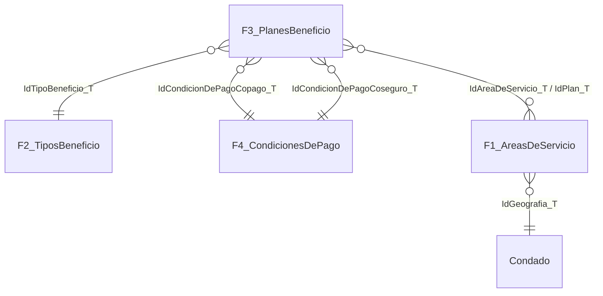

# Análisis del entregable 3 RaSA · Conclusión del entendimiento de datos

**Objetivo:** validar si es posible realizar los análisis de la matriz de temas analíticos de RaSA con las fuentes F1 a F4 de `RaSaTransaccional`, qué ajustes requiere su planteamiento y qué información adicional hace falta, además se documentan las columnas que permiten integrar las fuentes y la lista de supuestos y dudas para que la empresa las resuelva.

**Evidencia:** todas las cifras provienen del notebook `Proyecto_RaSa_entregable_3.ipynb`. El notebook aplica una preparación mínima en memoria y ejecuta un prototipo de cada análisis.

---

## 1. Resumen ejecutivo

Los análisis **sí son realizables** con las fuentes entregadas siempre que se cumplan tres condiciones:

1. **Recuperar los errores de carga que siguen patrones fijos.** Casi todo lo que el Entregable 2 marcó como huérfano, atípico o inválido es recuperable con reglas simples y verificables (sección 3).
2. **Reformular las preguntas basadas en "área de servicio".** Cada área de servicio pertenece a un solo plan así que 2.b, 2.c y 3.a tienen respuesta trivial si se plantean por área, eso sí deben medirse por **condado** o por **estado**.
3. **Obtener información adicional**: datos de 2019, un maestro de condados, el catálogo de niveles de servicio, los proveedores, el nivel metálico de los planes y las definiciones de negocio del indicador de deslealtad.

| Análisis | Veredicto | Ajuste o información requerida |
| :--- | :--- | :--- |
| 1.a Proveedor desleal | **Viable con ajustes** | Definir el umbral (relativo o en puntos), el tratamiento del valor 0 y qué nivel de servicio y condición de pago son comparables |
| 1.b Proveedores desleales por rango de fechas | **Viable con ajustes** | Las fechas son solo anuales y elegir lectura A (dentro del proveedor) o B (frente al mercado), además contar con el nivel metálico del plan |
| 2.a Nivel de cobertura por rango de años | **Viable con ajustes** | Medir sobre condados y contar con un maestro oficial de condados para el universo del país |
| 2.b ¿Cobertura total de los proveedores? | **Requiere reformulación** | Por área, ningún proveedor puede cubrirlas todas por construcción y medir la cobertura por estado |
| 2.c Áreas cubiertas por menos de dos proveedores | **Requiere reformulación** | Por área siempre hay un solo proveedor, se debe medir por condado |
| 3.a Planes por área de servicio | **Requiere reformulación** | Por área siempre hay un solo plan por lo que hay que medir por condado o estado |
| 3.b Concentración frente a habitantes | **Viable con ajustes** | Corregir la población (×10.000) y definir el criterio de "no corresponde" |
| 4.a Evolución de costos y beneficios | **Viable con información adicional** | Solo hay 2017 y 2018, por lo que se requieren los datos de 2019 |
| 4.b Beneficios que suben o bajan de costo | **Viable con ajustes** | Comparar mismo proveedor y beneficio definiendo la medida (promedio o mediana) |

---

## 2. Hallazgos que cambian la forma de abordar los análisis

### 2.1 El área de servicio es la huella geográfica de un plan, no una zona compartida

`NombreAreaDeServicio` incrusta el código del plan y el año. Por ejemplo, `BlueOptions16842FL0070128-032017260` contiene el plan `16842FL0070128-03` y el año `2017`. En los datos preparados:

* el 100 % de los nombres (145.242 filas distintas) contiene un código de plan, además
* cada una de las 5.409 áreas tiene **un solo nombre, un solo plan y un solo estado** que agrupa en promedio 21,7 condados (máximo 154), en F3 el plan de cada fila es siempre el mismo que figura en el nombre de su área (20.766 de 20.766 filas comparables).

**Consecuencia:** "planes por área" o "proveedores por área" siempre valen 1. La unidad geográfica que permite comparar es el **condado** (`IdGeografia_T`, código FIPS) y por ende el **estado**.

### 2.2 Los errores de calidad son, en su mayoría, errores de carga con patrón fijo

| Fuente | Problema (Entregable 2) | Patrón encontrado | Regla de recuperación | Filas afectadas | Recuperadas |
| :--- | :--- | :--- | :--- | ---: | ---: |
| F1 | `IdAreaDeServicio_T` nulo | Cada nombre de área corresponde a un único ID | Recuperar por `NombreAreaDeServicio` | 4.841 | 4.838 |
| F1 | `Fecha = 1800` | El año real está en el nombre y en el sufijo del ID | Año desde el nombre del área | 4.841 | 4.841 |
| F1 | 4.251 `IdGeografia_T` para 2.282 condados | En los 2.053 condados con dos códigos, el segundo es **el triple** del primero | Código mínimo por (Estado, Condado); dividido en 3 si queda fuera de rango | 24.207 | 24.207 |
| F1 | `IdGeografia_T` nulo | — | Código por (Estado, Condado) | 4.841 | 4.841 |
| F1 | Población > 20 millones | Es la población real **× 10.000** | Población mínima por condado | 4.841 | 4.841 |
| F1 | Área negativa | Es el **opuesto** del área real | Valor absoluto | 4.793 | 4.793 |
| F3 | Áreas huérfanas (1.097 IDs en el E2) | La mayoría tiene sufijo 4035/4036: ID real **+ 117.872.018** (el mayor ID de F1) | Restar 117.872.018 | 1.584 | 1.433 |
| F3 | Beneficios huérfanos (107 IDs en el E2) | Todos son el ID real **+ 1.055** (el mayor ID de F2) | Restar 1.055 | 1.584 | 1.584 |
| F3 | Fecha `1920-12-31` | El año real está en el sufijo del ID de área | Año desde el sufijo | 1.584 | 1.584 |
| F3 | Fecha `Dec 31,YYYY` | Mismo año en otro formato | Extraer el año de 4 dígitos | 1.584 | 1.584 |
| F3 | `IdPlan_T` vacío | El plan está en el nombre de su área en F1 | Plan del área | 1.584 | 1.448 |

**Validación de las reglas:**

* Tras corregir población y área la densidad reportada coincide con `Poblacion / Area` en el 100 % de las filas.
* Tras corregir la geografía todos los condados de cada estado comparten el prefijo FIPS del estado.
* El 100 % de los beneficios corregidos existe en F2.

Quedan **sin recuperar** en F3 los nulos sin patrón: 1.412 filas sin beneficio, 1.579 sin área y 136 sin plan, también quedan 2.317 filas cuya área no está en F1 en su mayoría de **18 planes que no tienen ninguna área en F1**.

### 2.3 Otros hallazgos estructurales

* **Granularidad temporal anual.** `Fecha` en F3 solo toma dos valores reales: el 31 de diciembre de 2017 y el de 2018, por lo que todo "rango de fechas" equivale a un rango de años y no existe 2019 en ninguna fuente.
* **Los costos no cambian entre áreas de un mismo plan.** En los 25.198 grupos (plan, beneficio, nivel, año), copago, coseguro y límite son constantes entre áreas, además solo 206 grupos aparecen en más de un área: F3 trae una muestra de áreas por plan no el detalle completo.
* **F2: el nombre es confiable, los atributos no.** El nombre es 1 a 1 con su ID (178 IDs y 178 nombres), en cambio de las 218 claves (beneficio y año) los atributos booleanos y la unidad del límite tienen valores contradictorios incluso tras homologar idiomas, por ejemplo `TieneLimiteCuantitativo` en 54 claves y `ExcluidoDelDesembolsoMaximoFueraDeLaRed` en 100.
* **F4: el rol de la condición lo da la columna de F3, no `Tipo`.** F3 usa 14 IDs de condición de copago y 5 de coseguro, hay IDs sinónimos como "Copay" con los IDs 238 y 714, el ID 204 es ambiguo ("Copay per Day" frente a "Copay per Stay after deductible").
* **El diccionario de datos no está alineado con la base.** Una tabla y cuatro campos tienen otro nombre: `FuentesPlanesBeneficio_Copia_E`, `idAreaServicio_T`, `idCondicionesDePagoCopago_T`, `idCondicionesDePagoCoseguro_T` y `EstaCubiertoPorSeguro`, tampoco documenta `IdNivelServicio_T` ni los proveedores.
* **El diccionario sí resuelve dos dudas del Entregable 1:** `Area` está en millas cuadradas y `Densidad` en habitantes por milla cuadrada.

---

## 3. Significado de una fila

| Conjunto preparado | Origen | Una fila representa | Llave |
| :--- | :--- | :--- | :--- |
| `areas_condados` | F1 | Un condado incluido en el área de servicio de un plan en un año (121.032 filas) | (`IdAreaDeServicio`, `IdGeografia`) |
| `condados` | F1 | Un condado con su población y su área en millas cuadradas (2.282 filas) | `IdGeografia` |
| `planes_beneficio` | F3 | Los costos de un tipo de beneficio en un nivel de servicio, de un plan, para una de sus áreas, en un año (27.543 filas) | (`IdPlan`, `IdTipoBeneficio`, `IdAreaDeServicio`, `IdNivelServicio_T`, `Anio`) |
| `beneficios_plan` | F3 | Lo mismo sin el área: base para los análisis de costos (25.198 filas) | (`IdPlan`, `IdTipoBeneficio`, `IdNivelServicio_T`, `Anio`) |
| `dim_beneficio` | F2 | Un tipo de beneficio (178 filas) | `IdTipoBeneficio` |
| `dim_condicion` | F4 | Una condición de pago | `IdCondicion` |

---

## 4. Columnas que permiten integrar las fuentes

| Relación | Columna en la fuente hija | Columna en la fuente padre | Cardinalidad | Condición previa |
| :--- | :--- | :--- | :--- | :--- |
| F3 → F1 | `FuentePlanesBeneficio_Copia_E.IdAreaDeServicio_T` | `FuenteAreasDeServicio_Copia_E.IdAreaDeServicio_T` | N:M (F1 es puente área–condado, hasta 156 condados por área) | Restar 117.872.018 a los IDs con sufijo 4035/4036 y recuperar IDs nulos de F1 por `NombreAreaDeServicio` |
| F3 → F1 (alterna) | `FuentePlanesBeneficio_Copia_E.IdPlan_T` | código de plan incrustado en `FuenteAreasDeServicio_Copia_E.NombreAreaDeServicio` | N:M | Extraer con la expresión regular `\d{5}[A-Z]{2}\d{7}-\d{2}`, tamnien permite recuperar `IdPlan_T` vacío |
| F3 → F2 | `FuentePlanesBeneficio_Copia_E.IdTipoBeneficio_T` | `FuenteTiposBeneficio_Copia_E.IdTipoBeneficio_T` (+ `Fecha` para atributos) | N:1 contra la dimensión (ID, nombre) | Restar 1.055 a los IDs mayores que 1.055 y resolver las colisiones de atributos por (ID, año) antes de usarlos |
| F3 → F4 (copago) | `FuentePlanesBeneficio_Copia_E.IdCondicionDePagoCopago_T` | `FuenteCondicionesDePago_Copia_E.IdCondicionesDePago_T` | N:1 | Quitar duplicados exactos y resolver el ID 204, comparar por `Descripcion` |
| F3 → F4 (coseguro) | `FuentePlanesBeneficio_Copia_E.IdCondicionDePagoCoseguro_T` | `FuenteCondicionesDePago_Copia_E.IdCondicionesDePago_T` | N:1 | Quitar duplicados exactos y comparar por `Descripcion` |
| Plan → proveedor | `IdProveedor_T` | 5 primeros caracteres de `IdPlan_T` | N:1 | Ninguna (coherencia del 100 %: 27.407 de 27.407 filas) |
| Área → condado | `FuenteAreasDeServicio_Copia_E.IdGeografia_T` (FIPS) | (`Estado`, `Condado`) | N:1 | Código mínimo por (Estado y Condado) |
| Tiempo | año de `F3.Fecha` | `F1.Fecha`, `F2.Fecha`, 4 últimos dígitos de `IdAreaDeServicio_T` | — | Extraer el año en F3 para recuperar 1800 y 1920 desde el ID del área |

**Calidad de cada cruce (filas hijas que encuentran su llave):**

| Relación | Crudo | Preparado | Efecto de un `JOIN` directo en crudo |
| :--- | ---: | ---: | :--- |
| F3 → F1 por área | 85,35 % | 91,08 % | Relación N:M esperada (puente) |
| F3 → F1 por plan | 85,68 % | 91,49 % | — |
| F3 → F2 | 94,04 % | 100 % | Un ID tiene hasta 29 filas en F2: 31.927 filas de F3 pasan a 294.990 |
| F3 → F4 copago | 100 % | 100 % | Hasta 3 filas por ID: 36.036 filas pasan a 37.017 |
| F3 → F4 coseguro | 100 % | 100 % | Hasta 3 filas por ID: 36.036 filas pasan a 67.152 |

> **Recomendación de integración:** unir F3 con F2 solo a través de la dimensión `(IdTipoBeneficio, Nombre)` y con F4 solo tras quitar duplicados. Por otro lado para cobertura cruzar pares distintos (plan y área) con F1, nunca las filas de beneficios.

---

## 5. Viabilidad por análisis

### Tema 1 · Comportamiento desleal de proveedores (1.a, 1.b) · Viable con ajustes

**Fuentes:** F2 (nombre del beneficio), F3 (costos) y F4 (condición de pago).

Solo se comparan costos del mismo año, beneficio, nivel de servicio y condición de pago, aunque como la definición de RaSA es ambigua se prototiparon dos lecturas:

| Lectura | Qué compara | 2017 | 2018 |
| :--- | :--- | :--- | :--- |
| **A · Dentro del proveedor** | Planes del mismo proveedor (máx. > 1,2 × mín.) | 1.752 grupos, 258 con alerta (47 por copago, 226 por coseguro) y 17 de 30 proveedores evaluables | 1.910 grupos, 371 con alerta (70 por copago, 311 por coseguro) y 21 de 46 proveedores evaluables |
| **B · Frente al mercado** | Promedio del proveedor frente a la mediana de los proveedores (≥ 3) | 8.093 combinaciones con 1.048 en alerta y 53 de 77 proveedores | 7.371 combinaciones con 1.416 en alerta y 66 de 88 proveedores |

**Hallazgos que condicionan la definición:**

* **Valores en 0.** Una parte importante de las alertas de la lectura A (75 en 2017 y 116 en 2018) existe solo porque el menor valor es 0, lo que da una diferencia relativa infinita.
* **Coseguro en puntos.** Si el 20 % del coseguro se mide en **puntos porcentuales** los grupos con diferencia de coseguro bajan de 226 a 53 (2017) y de 311 a 125 (2018).
* **Diferencias entre productos.** El patrón típico de alerta es 20 % frente a 40 % de coseguro entre planes del mismo proveedor, lo que es coherente con distintos **niveles metálicos** de plan (como el observado bronce frente a oro), ese dato no está en las fuentes.
* **Lectura B poco discriminante.** Marca cerca de tres de cada cuatro proveedores evaluables.
* **El 1.a ya funciona.** Se implementó como filtro sobre la lectura A, por ejemplo el proveedor 33602 tiene alertas en 104 de 624 grupos, mientras que el 54192 no tiene ninguna en 197 grupos.

**Ajustes:**

* Aplicar el "rango de fechas" como rango de años.
* Definir la lectura, el umbral y el tratamiento del 0.
* Comparar siempre dentro del mismo nivel de servicio y la misma condición de pago (por descripción).

### Tema 2 · Cobertura de planes (2.a, 2.b, 2.c) · Viable con ajustes y reformulación

**Fuentes:** F1 (área–condado) y F3 (plan–área). La cobertura calculada solo con F1, usando el plan incrustado en el nombre del área, da exactamente los mismos condados que el cruce F3–F1.

* **2.a** · El 68,1 % de los condados del universo F1 tiene al menos un plan en 2017 (1.553 de 2.282, 27 estados) y el 82,2 % en 2018 (1.875, 33 estados).
  * Hay estados presentes en un solo año: Alabama y Wyoming solo en 2017 mientras que Indiana, Louisiana, Ohio, Oregon, Pennsylvania, South Dakota, Virginia y West Virginia solo están presentes en 2018.
  * Hay caídas fuertes como Georgia (100 % → 20,1 %) y Oklahoma (100 % → 16,2 %).
* **2.b** · Por área es imposible por construcción, mientras que a nivel de condado:
  * Ningún proveedor opera en más de un estado.
  * El de mayor alcance cubre 159 condados (2017) o 120 (2018) de 2.282.
  * Por estado 27 de 72 proveedores cubren el 100 % de los condados de su estado en 2017 y 18 de 86 en 2018.
* **2.c** · Por área el 100 % tiene un solo proveedor. Por condado:

| Año | Sin plan | 1 proveedor | 2 proveedores | 3 o más | % de cubiertos con un solo proveedor |
| :--- | ---: | ---: | ---: | ---: | ---: |
| 2017 | 729 | 904 | 434 | 215 | 58,2 % |
| 2018 | 407 | 962 | 682 | 231 | 51,3 % |

**Ajustes:**

* Reformular 2.b como "proveedores que cubren todos los condados de los estados donde operan".
* Reformular 2.c como "condados cubiertos por menos de dos proveedores".
* Definir el universo de condados del país, porque F1 solo trae 35 estados y 2.282 condados.

### Tema 3 · Concentración de planes (3.a, 3.b) · Viable con ajustes y reformulación

**Fuentes:** F1 (condados y población) y F3.

* **3.a** · Por área siempre hay 1 plan, mientras que por condado hay en promedio 2,54 planes (2017) y 2,96 (2018) con un máximo de 15. La función del prototipo devuelve cuántos y cuáles planes hay por condado y rango de años, los condados con más planes (Wisconsin e Illinois) reciben la oferta de solo 1 o 2 proveedores.
* **3.b** · La correlación de Spearman entre población y planes es débil: 0,107 (2017) y 0,183 (2018), con un criterio de cuartiles se identifican dos grupos:
  * **Mucha población y pocos planes:** 116 condados en 2017 y 138 en 2018, por ejemplo Maricopa County (4,5 millones de habitantes) y Dallas County (2,6 millones) con 1 plan en 2018.
  * **Poca población y muchos planes:** 78 y 102 condado, por ejemplo los condados de South Dakota con menos de 1.500 habitantes y 4 planes.

**Ajustes:**

* Medir por condado o estado.
* Usar la población corregida.
* Que RaSA defina el criterio de "concentración que no corresponde con los habitantes" (por ejemplo planes por cada 100.000 habitantes o desviación frente a lo esperado).

### Tema 4 · Evolución de planes (4.a, 4.b) · Viable con información adicional

**Fuentes:** F2 y F3.

* **4.a** · Solo hay dos puntos en el tiempo, donde el conjunto ofrecido cambia mucho entre años: de 156 a 121 tipos de beneficio, de 77 a 90 proveedores y de 202 a 286 planes. El prototipo calcula el copago y el coseguro promedio por beneficio, proveedor y año.
* **4.b** · Cambio de 2017 a 2018:

| Comparación | Medida | Comparables | Aumentan | Disminuyen | Sin cambio |
| :--- | :--- | ---: | ---: | ---: | ---: |
| Agregada por beneficio | Copago | 95 | 36 | 45 | 14 |
| Agregada por beneficio | Coseguro | 99 | 69 | 26 | 4 |
| Mismo proveedor y beneficio | Copago | 838 | 97 | 97 | 644 |
| Mismo proveedor y beneficio | Coseguro | 1.152 | 386 | 351 | 415 |

El aumento agregado del coseguro se explica en buena parte por el **cambio en la mezcla** de proveedores y planes, comparando el mismo proveedor, las subidas y bajadas casi se compensan.

**Ajustes:**

* Usar la comparación por mismo proveedor y beneficio.
* Definir la medida (promedio o mediana) y si se pondera por planes o por áreas.
* Excluir las condiciones "Not Applicable" del promedio de cada medida.

**Información adicional:** los datos de 2019.

---

## 6. Análisis adicionales que se proponen a RaSA

1. **Dependencia de un solo proveedor por condado.** Más de la mitad de los condados cubiertos depende de un único proveedor, es un indicador de riesgo de abastecimiento y de poder de mercado, complementario a 2.c.
2. **Competencia efectiva: planes frente a proveedores.** Muchos planes no implican muchos competidores, dado que los condados con 15 planes tienen 1 o 2 proveedores.
3. **Entrada y salida de proveedores y estados entre años.** Por ejemplo los estados que aparecen o desaparecen y las caídas de cobertura de Georgia y Oklahoma.
4. **Accesibilidad: planes por cada 100.000 habitantes** por estado y condado.
5. **Cumplimiento de límites cuantitativos por proveedor** (regla de negocio 2 del Entregable 2), una vez RaSA resuelva las colisiones de atributos de F2.
6. **Oferta de beneficios esenciales (EHB) por plan y estado**, sujeta a la misma condición.
7. **Diferencias de costo por nivel de servicio** (por ejemplo dentro o fuera de la red), una vez se conozca el catálogo de `IdNivelServicio_T`.

---

## 7. Supuestos asumidos en este ejercicio

1. Los duplicados exactos son errores de extracción y se eliminan.
2. Los patrones de la sección 2.2 (desplazamientos de ID, factores ×3 y ×10.000, signo invertido, años 1800 y 1920) son errores de carga y el valor recuperado es el real.
3. `PoblacionAct` es una sola cifra por condado, válida para 2017 y 2018 donde la menor de las registradas es la real.
4. El universo de condados del país son los 2.282 condados presentes en F1.
5. El proveedor de un plan son los 5 primeros dígitos de `IdPlan_T` (coherencia del 100 %).
6. Como los costos son iguales en todas las áreas de un plan, los análisis de costos se hacen a nivel de plan sin área.
7. Solo son comparables los costos del mismo año, tipo de beneficio, nivel de servicio y descripción de la condición de pago.
8. "Diferencia mayor al 20 %" significa que el mayor valor supera en más de un 20 % al menor, si el menor es 0 y el mayor es positivo, la diferencia se considera mayor al 20 %.
9. En la lectura B el mercado de referencia es la mediana de los proveedores con el mismo beneficio y condiciones con al menos 3 proveedores.
10. Los promedios de copago y coseguro excluyen las filas cuya condición es "Not Applicable".
11. El ID de condición 204 se trata como ambiguo y no se compara con ninguna de sus dos descripciones.
12. El rol (copago o coseguro) de una condición lo define la columna de F3 en que aparece, no el campo `Tipo` de F4.

---

## 8. Dudas para RaSA

**Sobre la definición de los análisis**

1. En el análisis 1.b, ¿la diferencia del 20 % se mide entre planes del **mismo proveedor** o frente a **otros proveedores**? Si es frente al mercado, ¿cuál es el mercado de referencia (estado o país)?
2. ¿El 20 % es una variación relativa o para el coseguro (que ya es un porcentaje), una diferencia en puntos porcentuales? ¿Cómo se trata el caso en que uno de los valores es 0?
3. ¿Deben compararse los costos dentro del mismo nivel de servicio y la misma condición de pago? ¿Qué significan los niveles 1, 2 y 3 de `IdNivelServicio_T`?
4. ¿Se dispone del **nivel metálico** o tipo de cada plan? Sin él, diferencias normales entre productos pueden parecer deslealtad.
5. ¿Confirman que cada área de servicio pertenece a un solo plan? Si es así, ¿aceptan reformular 2.b, 2.c y 3.a por condado o por estado?
6. ¿Qué criterio define una "concentración de planes que no corresponde con la cantidad de habitantes" (3.b)?
7. En la evolución de costos (4.a, 4.b), ¿se compara por promedio o por mediana? ¿Se pondera por planes, por áreas o por población?

**Sobre diferencias entre lo declarado y lo observado**

8. Se declararon datos de 2017 a 2019, pero no hay 2019 en ninguna fuente. ¿Dónde están?
9. Se declararon 301 planes en 2017 y 422 en 2018, pero se observan 202 y 286 (aun recuperando el año 1920). ¿Cómo se contaron? ¿Falta información en la copia?
10. Se declararon 170 tipos de beneficio, pero F2 tiene 178. ¿Cuáles sobran o cómo se contaron?
11. Se declaró que las áreas cubren todos los condados del país, pero F1 solo tiene 2.282 condados de 35 estados. ¿Existe un maestro de condados que sirva de universo?
12. El copago máximo de 2018 es 3.500 (6 filas superan el tope de 3.300). ¿Es un error o el tope declarado está desactualizado?
13. Se declararon 15 condiciones de copago, pero F3 usa 14. ¿Cuál es el catálogo oficial? ¿Qué descripción es la correcta para el ID 204? ¿Los IDs con la misma descripción (por ejemplo, 238 y 714) son equivalentes? ¿Qué es la condición "Anticipado" del diccionario?

**Sobre la calidad y las reglas de recuperación**

14. ¿Confirman como errores de carga los desplazamientos de ID (+117.872.018 en áreas y +1.055 en beneficios), el factor ×3 en `IdGeografia_T`, el factor ×10.000 en la población, el área negativa y los años 1800 y 1920?
15. En F2 un mismo beneficio y año tiene valores contradictorios en `EsEHB`, `TieneLimiteCuantitativo`, exclusiones y unidad del límite. ¿Cuál es el valor vigente? ¿Estos atributos dependen del plan?
16. ¿Pueden enviar las áreas de servicio de los 18 planes de F3 que no aparecen en F1?
17. ¿A qué fecha corresponde `PoblacionAct`? ¿Hay población por año?
18. ¿Por qué 31 condados de Virginia (casi todos ciudades independientes) no tienen área? ¿Pueden completarla?
19. ¿Es esperado que F3 registre la mayoría de los beneficios de un plan en una sola de sus áreas? ¿Los costos pueden variar entre áreas de un mismo plan?

---

## 9. Información adicional requerida

| Información | Para qué análisis | Prioridad |
| :--- | :--- | :--- |
| Datos de 2019 (F1, F2, F3) | 4.a, 4.b, 1.b, 2.a, 3.a | Alta |
| Definición operativa del indicador de deslealtad (lectura, umbral, tratamiento del 0) | 1.a, 1.b | Alta |
| Maestro oficial de condados y estados del país (FIPS) | 2.a, 2.b, 2.c, 3.b | Alta |
| Catálogo de `IdNivelServicio_T` | 1.a, 1.b, 4.a | Media |
| Nivel metálico o tipo de cada plan | 1.a, 1.b | Media |
| Tabla de proveedores (nombre y estado) | Todos los tableros | Media |
| Tabla de grupos de áreas de servicio mencionada en la matriz | 2.a, 3.a | Media |
| Áreas de servicio de los 18 planes faltantes en F1 | 2.x, 3.x | Media |
| Resolución de las colisiones de atributos de F2 | Análisis propuestos 5 y 6 | Media |
| Catálogo oficial de condiciones de pago | 1.a, 1.b, 4.a | Baja |

---

## 10. Conclusión

El ejercicio de entendimiento de datos muestra que las fuentes de RaSA **permiten construir los cuatro temas analíticos**:

* La mayor parte de los problemas de calidad del Entregable 2 son errores de carga **deterministas y recuperables**, lo que hace viable la etapa de ETL.
* Las columnas de integración están identificadas y validadas con cruces del 91 % al 100 % tras la preparación.
* La principal corrección conceptual es que el **área de servicio no es una zona geográfica compartida**, sino la huella de un plan: los análisis de cobertura y concentración deben formularse por condado y estado.

Para cerrar la definición de los tableros, RaSA debe responder las dudas de la sección 8, en especial la definición de deslealtad, el universo de condados y la ubicación de los datos de 2019.